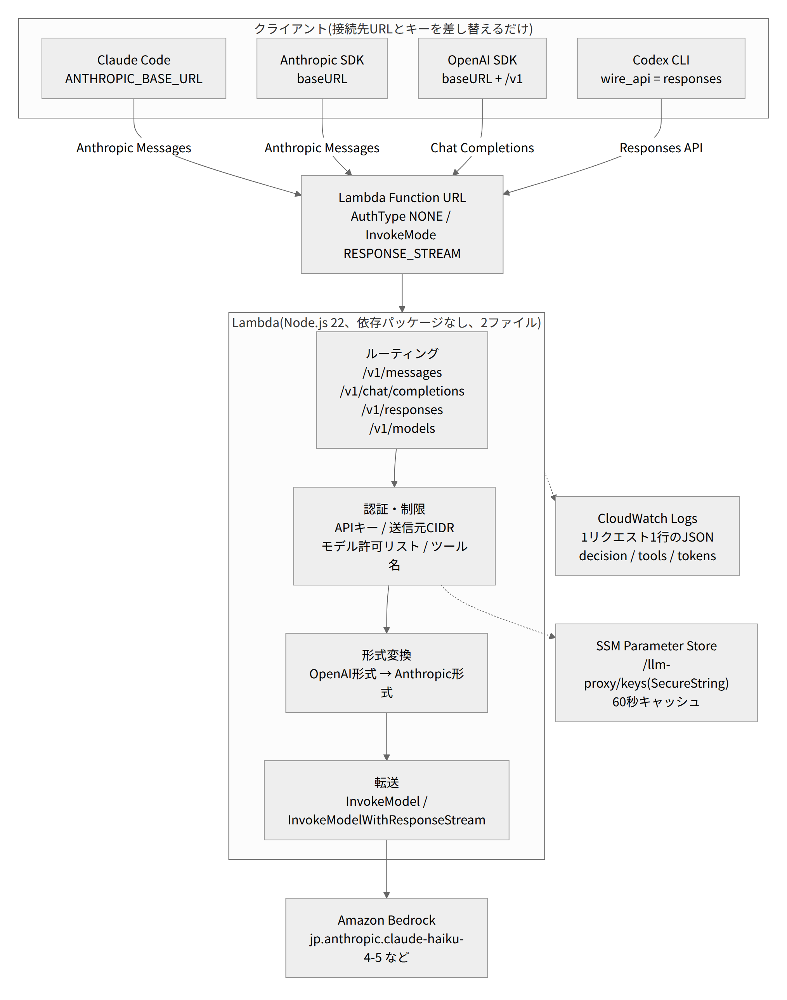

# simple-llm-proxy

AWS Lambda の Function URL で Anthropic Messages API 互換と OpenAI 互換(Chat Completions / Responses API)のリクエストを受け、
Amazon Bedrock に転送する簡易 LLM プロキシです。Claude Code、Anthropic SDK、OpenAI SDK、Codex CLI から接続先の差し替えだけで使えます。

- コードは 2 ファイル(約 570 行)、依存パッケージなし(AWS SDK v3 は Lambda ランタイム同梱)
- インフラは CloudFormation テンプレート 1 枚。固定費ゼロ
- API キーごとに、使えるモデル(エイリアス → Bedrock モデル ID)、ツール名の allow / deny、送信元 CIDR を制限
- 1 リクエスト 1 行の JSON ログを CloudWatch Logs に出力(キー名、モデル、ツール名、トークン数、判定理由)



設計と検証の経緯は Zenn の記事「Lambda+Bedrockで作る簡易LLMプロキシ(認証・制限・ログ)」にまとめています。

## 構成

| ファイル | 内容 |
| --- | --- |
| `src/index.mjs` | ルーティング・認証・制限・ログ・Bedrock 転送 |
| `src/openai.mjs` | OpenAI 形式(Chat Completions / Responses API)と Anthropic Messages 形式の相互変換。LiteLLM の変換を参考にした |
| `template.yaml` | CloudFormation(LogGroup、IAM ロール、Lambda、Function URL、Permission×2) |
| `deploy.sh` | `aws cloudformation package` + `deploy`。アーティファクト用 S3 バケットがなければ作る |
| `keys.example.json` | API キー設定の例。コピーして `keys.json` にする(git 管理外) |
| `cost-estimate.py` | 月額ランニングコストの試算スクリプト(単価と前提はファイル内に記載) |
| `docs/` | 構成図・シーケンス図(PNG と Mermaid ソース) |

## エンドポイント

| ルート | 形式 | 主なクライアント |
| --- | --- | --- |
| `POST /v1/messages` | Anthropic Messages API(ボディ透過) | Claude Code、Anthropic SDK |
| `POST /v1/chat/completions` | OpenAI Chat Completions | OpenAI SDK、OpenAI 互換クライアント |
| `POST /v1/responses` | OpenAI Responses API | Codex CLI、OpenAI SDK |
| `GET /v1/models` | キーに許可されたモデル一覧 | クライアントのモデル選択 |

認証は `x-api-key` または `Authorization: Bearer <key>`。ツール制限はどの形式でも「モデルに渡すツール定義の名前」で判定します。

## デプロイ

```bash
export AWS_REGION=ap-northeast-1
cp keys.example.json keys.json   # キー・モデル・ツール・CIDR を編集
aws ssm put-parameter --name /llm-proxy/keys --type SecureString --value file://keys.json --overwrite
./deploy.sh llm-proxy
```

Claude Code から使う場合は、Bedrock が受け付ける beta だけを許可リストに入れます(それ以外の `anthropic-beta` は落としてログに記録)。

```bash
./deploy.sh llm-proxy --parameter-overrides AllowedBetas="context-management-2025-06-27,interleaved-thinking-2025-05-14"
```

### パラメータ

| 名前 | 既定値 | 内容 |
| --- | --- | --- |
| `KeysParameterName` | `/llm-proxy/keys` | API キー設定を置く SSM パラメータ名 |
| `LogRetentionDays` | `30` | CloudWatch Logs の保持日数 |
| `AllowedBetas` | 空 | クライアントの `anthropic-beta` のうち Bedrock へ渡す値(カンマ区切り) |

## キー設定(`keys.json`)

```json
{
  "proxy-key-team-a-change-me": {
    "name": "team-a",
    "models": {
      "claude-haiku-4-5": "jp.anthropic.claude-haiku-4-5-20251001-v1:0",
      "claude-sonnet-4-5": "jp.anthropic.claude-sonnet-4-5-20250929-v1:0"
    },
    "tools": { "deny": ["bash", "computer"] },
    "cidrs": ["203.0.113.0/24"]
  }
}
```

- `models`: クライアントが送るモデル名(エイリアス)→ Bedrock モデル ID。許可リストを兼ねる
- `tools`: `allow`(列挙した名前だけ許可)か `deny`(列挙した名前を拒否)。ツール名は大文字小文字を区別する(Claude Code は `Bash`、Codex は `exec_command`)
- `cidrs`: 送信元 IP の許可リスト(IPv4。省略時は制限なし)

## クライアント設定

```bash
# Claude Code
export ANTHROPIC_BASE_URL=https://<function-url>
export ANTHROPIC_AUTH_TOKEN=<key>
export ANTHROPIC_MODEL=claude-haiku-4-5

# OpenAI SDK
new OpenAI({ baseURL: "https://<function-url>/v1", apiKey: "<key>" })
```

```toml
# Codex CLI: ~/.codex/config.toml
model_provider = "llmproxy"
model = "claude-haiku-4-5"

[model_providers.llmproxy]
name = "llm-proxy"
base_url = "https://<function-url>/v1"
env_key = "LLM_PROXY_KEY"
wire_api = "responses"
```

## 未対応・制限事項

- `previous_response_id`(ステートレスなので全履歴を送る)、`response_format` / `text.format` の `text` 以外、`n > 1`
- ホスト型ツール(`web_search` など)。落として `droppedTools` としてログに記録
- `/v1/messages/count_tokens`、埋め込みなど上記以外のエンドポイント
- レート制限・予算上限。CIDR 判定は IPv4 のみ
- Function URL は公開エンドポイント。WAF が必要なら CloudFront を手前に置き、Function URL を `AuthType: AWS_IAM` にする構成を検討する(未検証)

## 削除

```bash
aws cloudformation delete-stack --stack-name llm-proxy
aws ssm delete-parameter --name /llm-proxy/keys
```

## ライセンス

MIT
