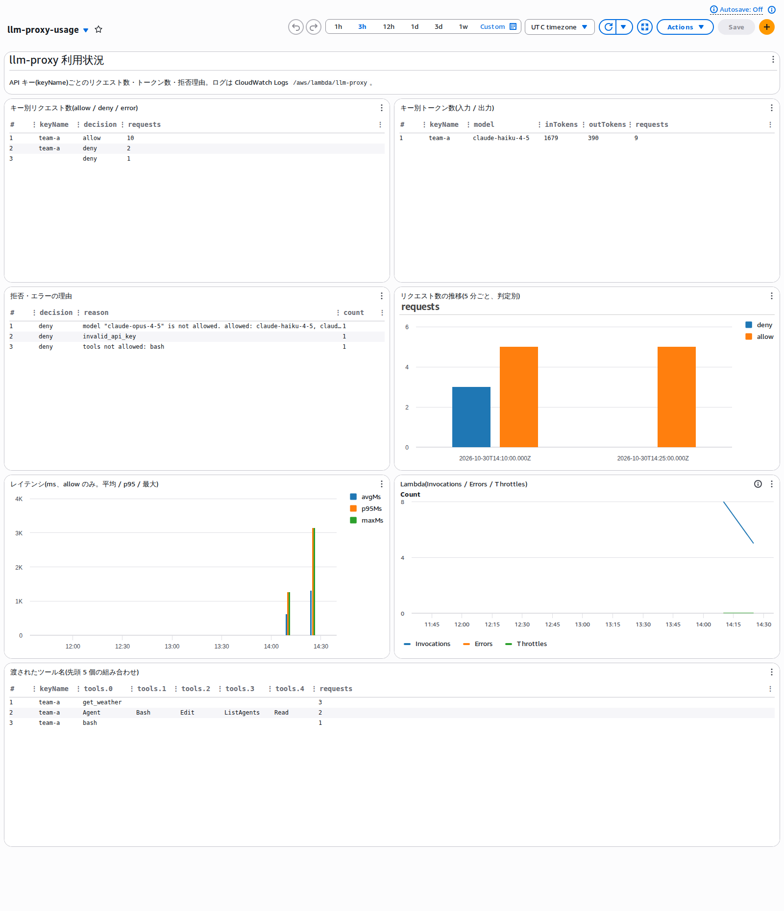
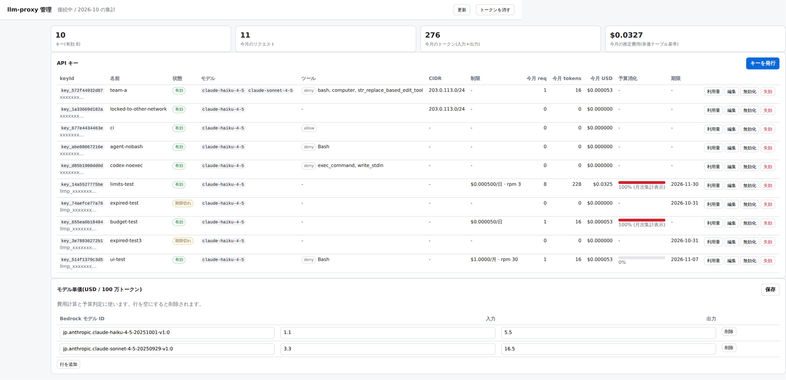

# simple-llm-proxy

AWS Lambda の Function URL で Anthropic Messages API 互換と OpenAI 互換(Chat Completions / Responses API)のリクエストを受け、
Amazon Bedrock に転送する簡易 LLM プロキシです。Claude Code、Anthropic SDK、OpenAI SDK、Codex CLI から接続先の差し替えだけで使えます。

- コードはプロキシ本体 3 ファイル + 管理 UI 2 ファイル(計約 950 行)、依存パッケージなし(AWS SDK v3 は Lambda ランタイム同梱)
- インフラは Terraform(Lambda、Function URL、IAM、ログ、ダッシュボード)。固定費ゼロ
- API キーは `keyctl.py` で発行・失効(保存は SHA-256 ハッシュ。平文は発行時に 1 回だけ表示)
- キーごとに、使えるモデル(エイリアス → Bedrock モデル ID)、ツール名の allow / deny、送信元 CIDR、有効期限を制限
- キーごとの利用量制限: 予算(USD、月次 / 日次)、RPM、TPM。超過は Bedrock を呼ぶ前に 429 で返す
- リクエストごとにモデル単価から費用を計算して DynamoDB に集計(分・日・月)。ログにも `costUsd` を出す
- 1 リクエスト 1 行の JSON ログを CloudWatch Logs に出力(キー名、モデル、ツール名、トークン数、判定理由)
- 利用状況の可視化: CloudWatch ダッシュボード(Terraform で作成)と、Markdown の利用レポートを出す `usage-report.py`
- 管理 UI: キーの発行・編集・無効化・失効、キー別の今月の利用量と推定費用、モデル単価の編集。別 Lambda + Function URL が HTML と JSON API を返す(フレームワーク・ビルド・CDN なし)






設計と検証の経緯は Zenn の記事「LambdaとBedrockで自作するLLMプロキシ(キー発行・予算・管理UI)」にまとめています。

## 構成

| ファイル | 内容 |
| --- | --- |
| `src/index.mjs` | ルーティング・認証・制限・ログ・Bedrock 転送 |
| `src/openai.mjs` | OpenAI 形式(Chat Completions / Responses API)と Anthropic Messages 形式の相互変換。LiteLLM の変換を参考にした |
| `terraform/` | Lambda、Function URL、IAM、DynamoDB(キーと利用量)、CloudWatch Logs、利用状況ダッシュボードの定義 |
| `usage-report.py` | Logs Insights からキー別・モデル別の利用状況と拒否理由を集計して Markdown 出力 |
| `src/keys.mjs` | API キーの照合(SHA-256)、利用量制限の判定、費用計算、利用量の記録(DynamoDB) |
| `keyctl.py` | API キーの発行・一覧・更新・無効化・失効・利用量表示・モデル単価の設定・旧 JSON の取り込み・管理 UI トークンの発行 |
| `src/admin.mjs` / `src/admin-ui.mjs` | 管理 UI(JSON API と単一ファイルの HTML)。管理トークン(SHA-256 ハッシュ保存)と任意の送信元 CIDR で保護 |
| `keys.example.json` | 旧形式(平文キー → 設定)の例。`keyctl.py import` で取り込める |
| `cost-estimate.py` | 月額ランニングコストの試算スクリプト(単価と前提はファイル内に記載) |
| `docs/` | 構成図・シーケンス図(PNG と Mermaid ソース) |

## エンドポイント

| ルート | 形式 | 主なクライアント |
| --- | --- | --- |
| `POST /v1/messages` | Anthropic Messages API(ボディ透過) | Claude Code、Anthropic SDK |
| `POST /v1/chat/completions` | OpenAI Chat Completions | OpenAI SDK、OpenAI 互換クライアント |
| `POST /v1/responses` | OpenAI Responses API | Codex CLI、OpenAI SDK |
| `GET /v1/models` | キーに許可されたモデル一覧 | クライアントのモデル選択 |

認証は `x-api-key` または `Authorization: Bearer <key>`。ツール制限はどの形式でも「モデルに渡すツール定義の名前」で判定します。

## デプロイ(Terraform)

```bash
cd terraform
terraform init
terraform apply
# Outputs: function_url, log_group_name, dashboard_url, keys_table_name
```

Claude Code から使う場合は、Bedrock が受け付ける beta だけを許可リストに入れます(それ以外の `anthropic-beta` は落としてログに記録)。

```bash
terraform apply -var 'allowed_betas=context-management-2025-06-27,interleaved-thinking-2025-05-14'
```

`authorization_type = "NONE"` の Function URL を Terraform で作ると、`lambda:InvokeFunctionUrl` と `lambda:InvokeFunction`(`InvokedViaFunctionUrl`)の 2 つの許可がプロバイダによって自動で付きます。

### 変数

| 名前 | 既定値 | 内容 |
| --- | --- | --- |
| `region` | `ap-northeast-1` | デプロイ先リージョン |
| `name` | `llm-proxy` | 関数名(ロググループ・ダッシュボード名にも使う) |
| `keys_table_name` | `llm-proxy-keys` | API キーと利用量を保存する DynamoDB テーブル名 |
| `allowed_betas` | 空 | クライアントの `anthropic-beta` のうち Bedrock へ渡す値(カンマ区切り) |
| `log_retention_days` | `30` | CloudWatch Logs の保持日数 |
| `memory_size` / `timeout` | `256` / `300` | Lambda のメモリ(MB)とタイムアウト(秒) |
| `create_dashboard` | `true` | 利用状況ダッシュボードを作るか |
| `create_admin_ui` | `true` | 管理 UI(別 Lambda + Function URL)を作るか |
| `admin_cidrs` | 空 | 管理 UI にアクセスできる送信元 CIDR(カンマ区切り)。トークン認証は常に必要 |

## API キーの発行と利用量制限(`keyctl.py`)

管理操作は公開エンドポイントに管理 API を置かず、IAM 権限で DynamoDB を直接操作する CLI に寄せています(攻撃面を増やさないため)。aws cli の認証情報で動き、boto3 は不要です。

```bash
# モデル単価(USD / 100 万トークン、入力:出力)。費用計算と予算判定に使う
python3 keyctl.py set-prices 'jp.anthropic.claude-haiku-4-5-20251001-v1:0=1.1:5.5,jp.anthropic.claude-sonnet-4-5-20250929-v1:0=3.3:16.5'

# キーを発行(平文はこのとき 1 回だけ表示される)
python3 keyctl.py create --name team-a \
  --models 'claude-haiku-4-5=jp.anthropic.claude-haiku-4-5-20251001-v1:0,claude-sonnet-4-5=jp.anthropic.claude-sonnet-4-5-20250929-v1:0' \
  --deny-tools Bash,exec_command --cidrs 203.0.113.0/24 \
  --budget-usd 50 --budget-period monthly --rpm 60 --tpm 200000 --expires-in-days 90

python3 keyctl.py list                      # 一覧(keyId、prefix、名前、制限、期限)
python3 keyctl.py usage key_xxxxxxxxxxxx    # 期間ごとの requests / tokens / costUsd
python3 keyctl.py update key_xxxxxxxxxxxx --budget-usd 100 --rpm 120
python3 keyctl.py disable key_xxxxxxxxxxxx  # 一時停止(enable で戻す)
python3 keyctl.py revoke key_xxxxxxxxxxxx   # 削除(利用量の履歴は残る)
python3 keyctl.py import keys.json          # 旧形式の JSON(平文キー → 設定)を取り込む
```

| 制限 | 判定 | 超過時 |
| --- | --- | --- |
| `--budget-usd` / `--budget-period` | 期間内の累計費用 ≥ 予算 | 429 `insufficient_quota`: `budget exceeded (x/y USD monthly)` |
| `--rpm` | 当該分のリクエスト数 ≥ RPM | 429 `rate_limit_error`: `rpm limit exceeded` |
| `--tpm` | 当該分の入力 + 出力トークン ≥ TPM | 429 `rate_limit_error`: `tpm limit exceeded` |
| `--expires-in-days` | 現在時刻 > 有効期限 | 403 `permission_error`: `api key expired at …` |
| `disable` | `disabled = true` | 403 `permission_error`: `api key is disabled` |

- 判定は Bedrock を呼ぶ前に、その時点までの累計で行う(ストリーミング中の分は次のリクエストから反映)。レースによる多少の超過は許容する設計。
- キー設定は Lambda コンテナごとに 60 秒キャッシュする。失効・無効化が効くまで最大 60 秒。
- 費用は `set-prices` で登録したモデル単価から計算する。単価未登録のモデルは費用 0 で記録し、ログに `unpriced: true` を出す。
- DynamoDB は 1 テーブル(オンデマンド)。キー 1 件のメタデータ、期間ごとの利用量(分は TTL で自動削除)、モデル単価の 3 種類の項目を置く。

## 可視化

### CloudWatch ダッシュボード(`<name>-usage`)

ログが 1 リクエスト 1 行の JSON なので、Logs Insights のクエリをそのままウィジェットにしています。

- キー別リクエスト数(allow / deny / error)
- キー別・モデル別トークン数(入力 / 出力)
- 拒否・エラーの理由
- リクエスト数の推移(5 分ごと、判定別)
- レイテンシ(平均 / p95 / 最大、5 分ごとの棒グラフ)
- Lambda の Invocations / Errors / Throttles
- 渡されたツール名(`tools.0`〜`tools.4`、先頭 5 個の組み合わせ)

アカウント内のカスタムダッシュボードは 3 枚まで無料、4 枚目以降は 1 枚 $3/月。ウィジェットの描画時に Logs Insights のスキャン課金がかかる(東京: $0.0076/GB)。

### 管理 UI(`<name>-admin`)

`terraform output admin_url` の URL をブラウザで開き、`keyctl.py admin-token` で発行した管理トークンを貼り付けます。トークンは sessionStorage にだけ保存され、タブを閉じると消えます。

```bash
python3 keyctl.py admin-token   # 平文はこのとき 1 回だけ表示。再実行で置き換え
```

- キー一覧: 状態(有効 / 無効 / 期限切れ)、モデル、ツール制限、CIDR、制限、今月のリクエスト数・トークン数・推定費用、予算消化率、有効期限
- キーの発行(平文は発行直後に 1 回だけ表示)、編集、無効化 / 有効化、失効
- キーごとの期間別利用量(日・月)
- モデル単価の編集

管理 UI の Lambda は、プロキシ本体とは別の IAM ロールで動きます(本体は GetItem / BatchGetItem / UpdateItem のみ、管理 UI は Scan / Query / PutItem / DeleteItem も持つ)。
公開 URL なので、`admin_cidrs` でオフィスや VPN の送信元に絞ることを推奨します。より強い認証が必要なら、Function URL を `AWS_IAM` にして CloudFront + Lambda@Edge や Cognito を前に置く構成に差し替えられます。

JSON API(`Authorization: Bearer <admin token>`):

| メソッド | パス | 内容 |
| --- | --- | --- |
| GET | `/api/keys` | 一覧 + 今月の利用量 |
| POST | `/api/keys` | 発行(応答に平文 `key`) |
| GET / PATCH / DELETE | `/api/keys/{keyId}` | 詳細(期間別利用量)/ 更新 / 失効 |
| GET / PUT | `/api/prices` | モデル単価 |

### 利用レポート(`usage-report.py`)

Slack や月次報告に貼る用途向けに、同じ集計を Markdown で出します。AWS CLI の認証情報を使い、boto3 は不要です。

```bash
python3 usage-report.py --hours 24 --region ap-northeast-1 [--profile NAME]
```

```markdown
## キー別(判定ごと)

| keyName | decision | requests | inTokens | outTokens |
| --- | --- | --- | --- | --- |
| team-a | allow | 5 | 62 | 31 |
| team-a | deny | 2 |  |  |
...
## 合計

- 許可リクエスト: 5
- 入力トークン: 62 / 出力トークン: 31
- 概算 Bedrock 費用(単価 入力 $1.1 / 出力 $5.5 per 1M tokens として): $0.0002
```

## キー設定(`keys.json`)

```json
{
  "proxy-key-team-a-change-me": {
    "name": "team-a",
    "models": {
      "claude-haiku-4-5": "jp.anthropic.claude-haiku-4-5-20251001-v1:0",
      "claude-sonnet-4-5": "jp.anthropic.claude-sonnet-4-5-20250929-v1:0"
    },
    "tools": { "deny": ["bash", "computer"] },
    "cidrs": ["203.0.113.0/24"]
  }
}
```

- `models`: クライアントが送るモデル名(エイリアス)→ Bedrock モデル ID。許可リストを兼ねる
- `tools`: `allow`(列挙した名前だけ許可)か `deny`(列挙した名前を拒否)。ツール名は大文字小文字を区別する(Claude Code は `Bash`、Codex は `exec_command`)
- `cidrs`: 送信元 IP の許可リスト(IPv4。省略時は制限なし)

## クライアント設定

```bash
# Claude Code
export ANTHROPIC_BASE_URL=https://<function-url>
export ANTHROPIC_AUTH_TOKEN=<key>
export ANTHROPIC_MODEL=claude-haiku-4-5

# OpenAI SDK
new OpenAI({ baseURL: "https://<function-url>/v1", apiKey: "<key>" })
```

```toml
# Codex CLI: ~/.codex/config.toml
model_provider = "llmproxy"
model = "claude-haiku-4-5"

[model_providers.llmproxy]
name = "llm-proxy"
base_url = "https://<function-url>/v1"
env_key = "LLM_PROXY_KEY"
wire_api = "responses"
```

## 未対応・制限事項

- `previous_response_id`(ステートレスなので全履歴を送る)、`response_format` / `text.format` の `text` 以外、`n > 1`
- ホスト型ツール(`web_search` など)。落として `droppedTools` としてログに記録
- `/v1/messages/count_tokens`、埋め込みなど上記以外のエンドポイント
- レート制限・予算上限。CIDR 判定は IPv4 のみ
- Function URL は公開エンドポイント。WAF が必要なら CloudFront を手前に置き、Function URL を `AuthType: AWS_IAM` にする構成を検討する(未検証)

## 削除

```bash
cd terraform && terraform destroy   # DynamoDB テーブル(キーと利用量)も消える
```

## ライセンス

MIT
